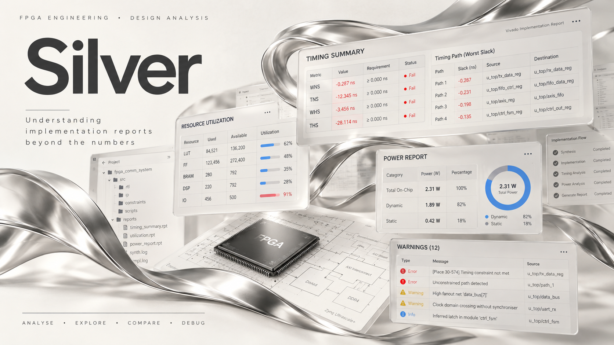

# Silver

**An engineering analysis tool for AMD Vivado implementation reports.**

Silver helps FPGA engineers understand what happened during implementation — without manually reading through hundreds of pages of timing reports, utilisation summaries, and routing logs.

[**⬇ Download Latest Release**](../../releases/latest) &nbsp;·&nbsp; [**📖 Documentation**](https://substack.com/@vaibhav5555/note/p-222749342)

---

## What is Silver?

Working with AMD Vivado FPGA designs means dealing with dense implementation reports. A single project run can produce timing reports, resource utilisation summaries, routing details, and constraint analyses — all in formats that take significant time to read through manually.

Silver processes these reports, extracts the information that matters most, and presents it in a more accessible format. The goal is to reduce the time engineers spend navigating lengthy outputs so they can focus on their design.

---

## Features

- **Report loading** — Select and load implementation reports from your Vivado project
- **Automated parsing** — Extracts structured information from loaded reports
- **Resource utilisation** — Presents utilisation data from implementation results
- **Timing information** — Surfaces timing-related findings from the report
- **Warning identification** — Highlights warnings and issues present in the reports
- **Formatted output** — Presents extracted information in a cleaner, more navigable format
- **Select-all support** — Quickly select all optional file types when loading reports

---

## Screenshots

> Screenshots of Silver in use will be added here. If you would like to contribute a screenshot, open an Issue.

---

## Download and Installation

### System Requirements

- Windows 10 or later (64-bit)
- No additional software required

### Steps

1. Go to the [**Releases page**](../../releases).
2. Under the latest release, download the `.exe` file from the **Assets** section.
3. Run the downloaded file.

> **Windows SmartScreen notice:** Because Silver is not yet code-signed, Windows may show a
> "Windows protected your PC" warning. If this happens, click **More info**, then
> **Run anyway**. We are working to add code signing in a future release.

---

## Documentation

For a detailed explanation of Silver, its features, and practical examples:

[**Read the Silver article on Substack →**](https://substack.com/@vaibhav5555/note/p-222749342)

---

## Roadmap

### Currently Supported

- AMD Vivado implementation report analysis
- Resource utilisation extraction
- Timing report processing
- Warning and issue identification

### Under Development

- Improved report coverage
- Additional Vivado report types
- User experience improvements

### Future EDA Integrations *(Planned — not yet available)*

- AMD Vitis
- Vitis HLS
- Intel Quartus Prime
- Synopsys EDA tools
- Cadence EDA tools

---

## Feedback and Support

**Bug reports and feature requests:**
Open an [Issue](../../issues) on this repository. Describe what you were doing, what you expected, and what happened.

**General feedback:**
[bvsrvaibhav@gmail.com](mailto:bvsrvaibhav@gmail.com)

**Documentation questions:**
Refer to the [Substack article](https://substack.com/@vaibhav5555/note/p-222749342) or open an Issue.

---

## About the Team

Silver is developed by three engineering students — **Vaibhav**, **Vignesh**, and **Praveen**.

The project grew out of their experience working with FPGA development and EDA tools. Reading through Vivado implementation reports is a regular part of FPGA engineering, and that experience motivated them to build something that makes the process faster and more approachable.

---

## Proprietary Software Notice

Silver is proprietary software. This repository provides publicly downloadable application releases and documentation only. The application source code is not distributed through this repository. Use and redistribution are subject to the applicable terms of use.

---

